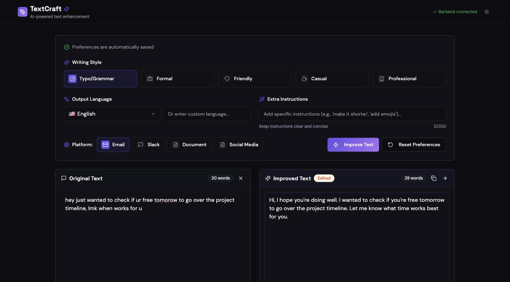

# TextCraft

AI-powered text enhancement — paste in rough writing, pick a style, platform, and language, and get a polished version back. Built with a Go API and a React frontend, with a fallback path so it still works without an AI key.

🔗 Live at [tc.wolka.dev](https://tc.wolka.dev)



## Features

- AI-powered text improvement via the Groq API, with a local fallback if no key is set
- Five writing styles: typo/grammar fix, formal, friendly, casual, professional
- Platform-aware output for email, Slack, documents, and social media
- Multi-language output, including custom/free-text languages
- Light and dark mode
- Preferences (style, platform, language) persisted locally per browser

## Quick Start

### Using Docker (Recommended)

1. Clone the repository
2. Set your Groq API key:
   ```bash
   export GROQ_API_KEY=your_api_key_here
   ```
3. Run with Docker Compose:
   ```bash
   docker-compose up
   ```
4. Open http://localhost:33000

`./docker-run.sh` also wraps common Docker workflows (`dev`, `prod`, `stop`, `clean`, `logs`, `status`) — run it without arguments to see usage.

### Manual Setup

Requires Go 1.21+ and Node 18+.

**Backend (Go API):**

```bash
cd api
go mod tidy
go run main.go
```

**Frontend (React):**

```bash
cd ui
npm install
npm run dev
```

## Project Structure

```
api/   Go backend — text improvement endpoint, Groq integration, rate limiting
ui/    React + TypeScript frontend — Vite, Tailwind CSS, shadcn/ui
```

## API

### `POST /api/improve-text`

```bash
curl -X POST http://localhost:38080/api/improve-text \
  -H "Content-Type: application/json" \
  -d '{
    "text": "hey just wanted to check if ur free tomorow",
    "style": "professional",
    "platform": "email",
    "language": "en"
  }'
```

| Field | Required | Notes |
|---|---|---|
| `text` | yes | Max 200 words |
| `style` | yes | `typo-grammar`, `formal`, `friendly`, `casual`, `professional` |
| `platform` | no | `email`, `slack`, `document`, `social` |
| `language` | no | ISO code (`en`, `es`, `fr`, `de`, `it`, `pt`, `tr`) |
| `customLanguage` | no | Free-text language, overrides `language` |
| `extraPrompt` | no | Additional instructions, max 200 characters |

Rate-limited to one request per 5 seconds per client IP. Requests are capped at 64KB.

### `GET /health`

Returns service status — used for container health checks.

## Environment Variables

| Variable | Required | Default | Description |
|---|---|---|---|
| `GROQ_API_KEY` | no | — | Groq API key for AI text processing. Falls back to basic local processing if unset. |
| `GROQ_MODEL` | no | `openai/gpt-oss-20b` | Groq model ID. Change it here when Groq retires a model ([deprecations](https://console.groq.com/docs/deprecations)). |
| `ALLOWED_ORIGIN` | no | `https://tc.wolka.dev` | CORS origin the API accepts requests from. |

## Tech Stack

- **Frontend**: React 18, TypeScript, Tailwind CSS, shadcn/ui, next-themes
- **Backend**: Go, Gorilla Mux
- **AI**: Groq API with fallback processing
- **Deployment**: Docker, Docker Compose

## License

MIT — see [LICENSE](LICENSE).
